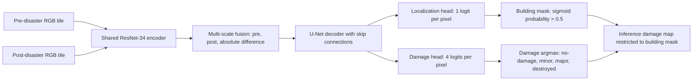

# Rubicon xBD v3 Training Report

## Executive summary

Rubicon's satellite damage-assessment prototype uses a dual-task Siamese
U-Net to compare pre- and post-disaster optical images. The shared encoder
extracts features from both images; a U-Net decoder predicts building
localization and four-way damage classes.

The v3 real-xBD run trained for all six requested epochs on 769 selected
training tiles and evaluated on all 234 event-disjoint validation tiles.
Training used an NVIDIA RTX 3050 6 GB GPU, batch size 2, gradient accumulation
2 (effective batch size 4), and 1,152 optimizer steps. The best validation
xView2 score was **0.2332 at epoch 5**. Validation localization F1 was **0.6824**,
damage macro F1 was **0.3569**, and damage harmonic F1 was **0.0407**.

These are real-data prototype results, not evidence of production readiness.
Damage performance remains weak, particularly for minor and major damage.
The evaluation set contains only 10,511 minor-damage pixels and only two
disaster events, so the aggregate should be interpreted cautiously.

## 1. Model selection and intended use

The selected model is the xBD Siamese U-Net, not Rubicon's separate legacy
HSI/LiDAR experiment. xBD provides paired optical imagery before and after a
disaster and building-damage labels. A shared Siamese encoder can represent
both scenes in the same feature space, while pre/post feature differences
make changes available to the decoder. A U-Net-style decoder preserves
spatial detail needed for pixel-level localization and damage maps.

The choice is a task-aligned prototype design; this run did not benchmark
alternative architectures and does not establish that Siamese U-Net is
empirically superior to them.

## 2. Architecture



### Encoder and fusion

- One ResNet-34 encoder (ImageNet-pretrained weights enabled) is called for
  both images; its weights are shared.
- At each encoder scale, the feature tensors are concatenated as
  `[pre, post, abs(post - pre)]`.
- A 512-channel bottleneck feeds four decoder blocks with output widths
  `(256, 128, 64, 32)`. Decoder blocks upsample, concatenate their fused
  encoder skip feature, then apply two convolution / batch-normalization /
  ReLU layers.
- The final decoder features are upsampled to input resolution and passed to
  two heads: one localization channel and four damage channels.
- The run's model has **33,111,957 parameters**, all trainable.

### Output semantics

xBD target IDs are `0=background`, `1=no-damage`, `2=minor-damage`,
`3=major-damage`, and `4=destroyed`. The damage head has four channels for
building classes only. At inference, Rubicon thresholds the localization
probability at `> 0.5`; damage class is the argmax over the four damage logits
inside that predicted building mask. Background belongs to localization,
not the damage classifier.

## 3. Dataset and split

The run used the local real xBD dataset, with paired pre/post RGB imagery and
polygon label JSON rasterized to localization and damage masks. The repository
dataset inventory records 2,799 paired tiles in `train/` and 933 paired tiles
in `hold/`. The experiment used `train/` only:

| Partition | Events | Available tiles | Tiles used |
|---|---|---:|---:|
| Training | Guatemala volcano, Florence, Harvey, Matthew, Michael, Midwest flooding, Santa Rosa wildfire, Southern California fire | 2,565 | 769 (30%) |
| Event-disjoint validation | Mexico earthquake, Palu tsunami | 234 | 234 (100%) |
| `hold/` | Tile-level holdout from events also represented in `train/` | 933 | 0 |

The 769-tile subset was selected from the 2,565 training tiles using a
deterministic NumPy subset-selection seed of 42. Training tiles were shuffled
without a weighted sampler; class imbalance was addressed with class weights
instead. Validation included all 234 tiles, without a tile-count cap; the
validation loader used the centered 512 × 512 crop from each tile. The model
was selected using this event-disjoint validation set. No `hold/` data was
read for training or reported evaluation.

The validation split covers only two events, so it is a limited estimate of
generalization to new disasters. `hold/` is not a substitute for another
event-disjoint test set because its events overlap those in `train/`.

### Validation label distribution

Damage metrics use the 13,373,915 ground-truth building pixels:

| Class | Ground-truth pixels | Share |
|---|---:|---:|
| No-damage | 12,697,990 | 94.95% |
| Minor-damage | 10,511 | 0.08% |
| Major-damage | 164,608 | 1.23% |
| Destroyed | 500,806 | 3.74% |

The small minor-damage support makes its F1 particularly sensitive to a small
number of changed predictions. Pixel counts are not counts of buildings or
independent examples.

## 4. Training procedure and hyperparameters

| Setting | v3 value |
|---|---|
| Run mode | Real xBD |
| Hardware profile | `local_6gb` |
| Device | NVIDIA GeForce RTX 3050 Laptop GPU, 6 GB VRAM |
| Encoder | ResNet-34, ImageNet pretrained |
| Input crop | 512 × 512 pixels |
| Batch size | 2 |
| Gradient accumulation | 2 microbatches |
| Effective batch size | 4 |
| Training batches per epoch | 384 |
| Optimizer steps per epoch | 192 |
| Epochs requested / completed | 6 / 6 |
| Total optimizer steps | 1,152 |
| Optimizer | AdamW |
| Learning rate | 0.0003 |
| Weight decay | 0.0001 |
| Learning-rate schedule | `linear_warmup_cosine`; configured with 1 warmup epoch |
| Mixed precision | CUDA autocast fp16 with gradient scaling |
| Gradient clipping | Global norm 1.0 |
| Localization loss weight | 0.4 |
| Damage loss weight | 0.6 |
| Damage focal gamma | 2.0 |
| Tile sampling | Shuffle only; no weighted oversampling |
| Normalization | Per-channel RGB mean/std fitted on a deterministic sample of up to 100 training tiles (resized to 128 × 128) and saved in checkpoint |
| Training duration | 3,127.68 seconds (about 52.1 minutes) |

Training crops are random 512-pixel crops with independent horizontal and
vertical flips (each with probability 0.5). Validation uses centered crops.
Automatic CUDA out-of-memory recovery can reduce crop size; the v3 run's
recorded crop size was 512.

The loss is:

- Localization: binary cross-entropy with logits plus soft Dice loss.
- Damage: weighted four-class cross-entropy plus weighted focal loss, applied
  only to ground-truth building pixels. Focal gamma is 2.
- Total: `0.4 * localization_loss + 0.6 * damage_loss`.

The damage weights were computed from the selected 769 training tiles using
normalized inverse-square-root pixel frequencies, capped at 10:

| Class | Training building pixels | Weight |
|---|---:|---:|
| No-damage | 21,805,566 | 0.491263 |
| Minor-damage | 4,305,106 | 1.105620 |
| Major-damage | 6,096,540 | 0.929086 |
| Destroyed | 2,422,044 | 1.474031 |

The training program warns if one predicted damage class exceeds 90% of
predicted building pixels after epoch 2. In v3 this is warning-only and
never interrupts the run. Validation xView2 score patience remains a separate
early-stopping mechanism; it did not stop this six-epoch run.

### Step count calculation

With 769 selected training tiles, batch size 2 and `drop_last=True`, the
loader produced 384 batches per epoch. Accumulating each pair of batches
produced 192 optimizer steps per epoch; `192 * 6 = 1,152` optimizer steps in
the completed run. The effective batch size is `2 * 2 = 4`.

## 5. Evaluation definitions

All reported final metrics below are from the standalone evaluator using the
best checkpoint on all 234 event-disjoint validation tiles. For this run,
each 1024 × 1024 tile was evaluated through its centered 512 × 512 crop; all
tiles were included, but pixels outside those validation crops were not
scored.

- **Localization F1:** binary building mask F1 at localization probability
  threshold `> 0.5`.
- **Damage precision, recall and F1:** a four-class confusion matrix over
  ground-truth building pixels. Damage is chosen by argmax over the four
  damage channels; these class metrics do not remove pixels based on predicted
  localization.
- **Damage macro F1:** arithmetic mean of the four per-class damage F1 scores,
  giving each class equal weight.
- **Damage harmonic F1:** harmonic mean of the four per-class damage F1 scores
  (with the implementation's small numerical epsilon).
- **xView2 score:** `0.3 * localization_F1 + 0.7 * damage_harmonic_F1`.
- **Predicted class histogram:** a separate diagnostic over pixels for which
  localization probability is `> 0.5`, grouped by the damage argmax. It is not
  the population used to calculate the GT-building-only damage confusion
  matrix.

## 6. Results

### Epoch-level validation trajectory

The following values are from the trainer's epoch logs. Histograms are
percentages inside the predicted building mask, ordered no-damage / minor /
major / destroyed. The GT histogram was constant across epochs:
`94.95% / 0.08% / 1.23% / 3.74%`.

| Epoch | Loc F1 | Damage macro F1 | Damage harmonic F1 | xView2 | Predicted class histogram (%) |
|---:|---:|---:|---:|---:|---|
| 1 | 0.4126 | 0.2425 | 0.0000 | 0.1238 | 76.27 / 2.47 / 21.20 / 0.06 |
| 2 | 0.4083 | 0.2407 | 0.0004 | 0.1228 | 91.01 / 0.85 / 0.00 / 8.14 |
| 3 | 0.5730 | 0.3144 | 0.0000 | 0.1719 | 98.65 / 0.03 / 0.00 / 1.32 |
| 4 | 0.6226 | 0.3211 | 0.0038 | 0.1894 | 96.26 / 0.00 / 0.04 / 3.70 |
| 5 | 0.6824 | 0.3569 | 0.0407 | **0.2332** | 91.52 / 2.23 / 0.73 / 5.53 |
| 6 | 0.6011 | 0.3113 | 0.0155 | 0.1912 | 90.62 / 0.00 / 0.95 / 8.43 |

The collapse warning fired after epochs 2–6 and training continued through
epoch 6. Epoch 5 was selected as best by validation xView2 score.

| Epoch | Train loss | Validation loss | Optimizer steps |
|---:|---:|---:|---:|
| 1 | 1.5474 | 1.2734 | 192 |
| 2 | 1.3767 | 1.4125 | 192 |
| 3 | 1.3260 | 1.0694 | 192 |
| 4 | 1.2363 | 1.0381 | 192 |
| 5 | 1.1356 | 1.0009 | 192 |
| 6 | 1.1358 | 1.1029 | 192 |

### Per-class training validation precision / recall / F1

Values below are the trainer's per-epoch validation output; class order is
no-damage, minor, major, destroyed.

| Epoch | No-damage P / R / F1 | Minor P / R / F1 | Major P / R / F1 | Destroyed P / R / F1 |
|---:|---|---|---|---|
| 1 | .9492 / .9742 / .9615 | .0017 / .0488 / .0034 | .0000 / .0000 / .0000 | .0592 / .0026 / .0050 |
| 2 | .9847 / .6775 / .8027 | .0006 / .0428 / .0011 | .0909 / .0001 / .0001 | .0898 / .6881 / .1589 |
| 3 | .9778 / .8658 / .9184 | .0047 / .1411 / .0092 | .0000 / .0000 / .0000 | .2105 / .7643 / .3301 |
| 4 | .9765 / .8935 / .9332 | .0011 / .0125 / .0021 | .0091 / .0010 / .0018 | .2274 / .7357 / .3475 |
| 5 | .9776 / .9247 / .9504 | .0269 / .1250 / .0442 | .0209 / .0104 / .0138 | .2948 / .7258 / .4193 |
| 6 | .9805 / .8531 / .9124 | .0035 / .0093 / .0051 | .0205 / .0159 / .0179 | .1908 / .8268 / .3100 |

### Best-checkpoint full validation result

The standalone evaluator's rounded results for the epoch-5 best checkpoint:

| Metric | Result |
|---|---:|
| xView2 score | **0.2332** |
| Localization F1 | 0.6824 |
| Damage harmonic F1 | 0.0407 |
| Damage macro F1 | 0.3569 |

| Class | Precision | Recall | F1 | GT building pixels |
|---|---:|---:|---:|---:|
| No-damage | 0.9776 | 0.9246 | 0.9504 | 12,697,990 |
| Minor-damage | 0.0268 | 0.1248 | 0.0441 | 10,511 |
| Major-damage | 0.0209 | 0.0104 | 0.0138 | 164,608 |
| Destroyed | 0.2948 | 0.7260 | 0.4193 | 500,806 |

Confusion matrix (rows are ground truth; columns are prediction; order is
no-damage, minor, major, destroyed):

```text
[[11741005, 41585, 70414, 844986],
 [    8826,  1312,    11,    362],
 [  137449,  1069,  1705,  24385],
 [  122671,  4963,  9604, 363568]]
```

Best-checkpoint predicted class histogram inside the predicted building mask:

| Class | Pixels | Share |
|---|---:|---:|
| No-damage | 14,921,840 | 91.52% |
| Minor-damage | 362,179 | 2.22% |
| Major-damage | 118,624 | 0.73% |
| Destroyed | 902,514 | 5.54% |

The trainer computes its epoch metrics in the training loop; the standalone
evaluator reloads the serialized best checkpoint and recomputes validation.
Small last-decimal differences (for example minor F1 0.0442 in the epoch
history versus 0.0441 in standalone evaluation) are rounding/runtime
differences. Use the standalone evaluator JSON as the final evaluation
record.

## 7. Limitations and honest interpretation

1. **Damage classification is not yet reliable.** The xView2 score remains
   low, damage harmonic F1 is 0.0407, and major-damage F1 is 0.0138. The model
   predicts no-damage for 91.52% of pixels in its predicted building mask.
2. **Rare-class uncertainty:** only 10,511 validation pixels are minor damage.
   Pixelwise F1 does not provide an independent-sample confidence interval;
   spatially adjacent pixels are correlated.
3. **Few validation events:** 234 tiles are drawn from only Mexico earthquake
   and Palu tsunami. The score may not generalize to other disasters, sensors,
   or geographies. Per-event evaluation and additional event-disjoint data are
   recommended.
4. **Short, subset run:** only 30% of training tiles and six epochs were used.
   This is a prototype diagnostic, not a fully tuned or converged model.
5. **Threshold and aggregation:** localization uses a fixed 0.5 threshold.
   No threshold tuning, calibration, or building-polygon-level scoring was
   performed for this report.
6. **Reproducibility:** the subset selection uses seed 42, but the training
   loop does not establish full deterministic seeds for shuffling,
   augmentation, CUDA kernels, and all worker processes. Exact metric
   reproduction is therefore not guaranteed.
7. **No holdout claim:** `hold/` was not read for this run. Do not describe the
   reported metrics as holdout/test metrics.

### Mentor questions to be ready for

- **Why Siamese U-Net?** It compares paired pre/post scenes using shared
  features and explicit feature differences, then produces spatial masks for
  localization and damage.
- **Why two heads?** Localization decides building versus background;
  damage classifies severity only where a ground-truth building is present
  during training. At inference the localization mask gates damage output.
- **Why class weights?** Damage frequencies are highly imbalanced. The
  inverse-square-root weights provide moderate compensation without also
  oversampling rare classes.
- **Why is macro F1 much larger than harmonic F1?** Macro F1 averages the
  four classes; the harmonic mean is strongly reduced by near-zero minor and
  major damage F1. The xView2 score uses the harmonic damage F1, not macro F1.
- **What does the 90% warning mean?** It is a diagnostic that logs a dominant
  predicted class after epoch 2; v3 does not stop on it.
- **Can these results support deployment?** They support demonstrating the
  training and inference pipeline, not operational damage decisions. Improve
  rare-class performance and validate across more independent events first.

## 8. Reproduction and artifacts

From the `ai-engine` directory, with a local xBD root containing `train/` and
`hold/`:

```powershell
$XbdRoot = "D:\datasets\xbd"
python train.py --xbd-root $XbdRoot --config auto --epochs 6 --subset 0.3 `
  --output-dir data/models/xbd-v3 --log-dir runs/xbd-v3
python eval.py --xbd-root $XbdRoot `
  --checkpoint data/models/xbd-v3/checkpoint_best.pt --split val `
  --output-dir data/models/xbd-v3/eval-val
```

Run outputs are local and excluded from Git because of their size and dataset
provenance. This report is committed; the checkpoint and raw run logs are not
bundled in the repository.

| Artifact | Purpose |
|---|---|
| `data/models/xbd-v3/training_metrics.json` | Hyperparameters, selected subset counts/weights, event split, step counts, warnings, and epoch history |
| `data/models/xbd-v3/checkpoint_best.pt` | Best epoch-5 weights and inference configuration |
| `data/models/xbd-v3/checkpoint_last.pt` | Final epoch-6 resumable state |
| `data/models/xbd-v3/eval-val/metrics.json` | Standalone full-validation metrics and confusion matrix |
| `data/models/xbd-v3/eval-val/confusion_matrix.png` | Confusion-matrix visualization |
| `data/models/xbd-v3/eval-val/eval_overlay_*.png` | Qualitative imagery, ground truth, and predictions |
| `runs/xbd-v3/training.log` | Console output, including per-epoch metrics/histograms |

The checkpoint recorded file SHA-256 prefix `edfdf52296674508`; its state-dict
hash recorded by the evaluator is `71e1b06492c61d7b`. The training run used
Python 3.13.15, PyTorch 2.10.0+cu128, segmentation-models-pytorch 0.6.0,
and NVIDIA CUDA 12.8 with PyTorch AMP.

Related implementation and operational details are in the
[xBD training guide](./training.md), [xBD data guide](./data.md), and
[AI engine README](../ai-engine/README.md).
